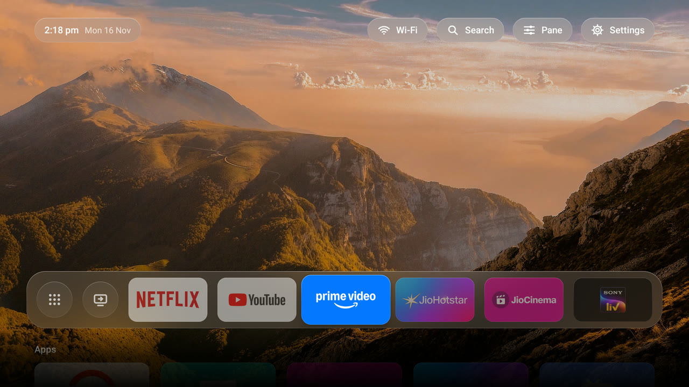
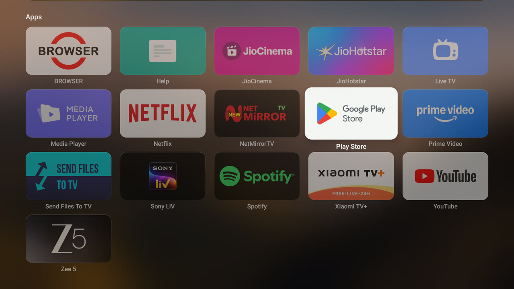
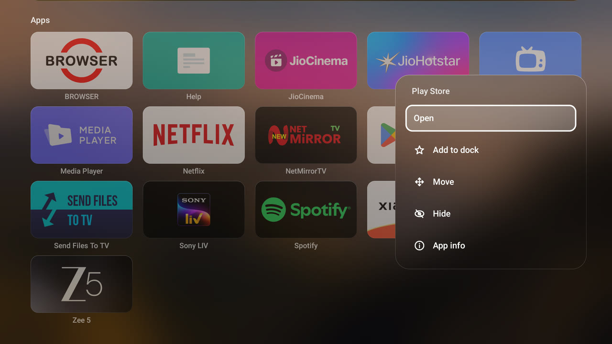
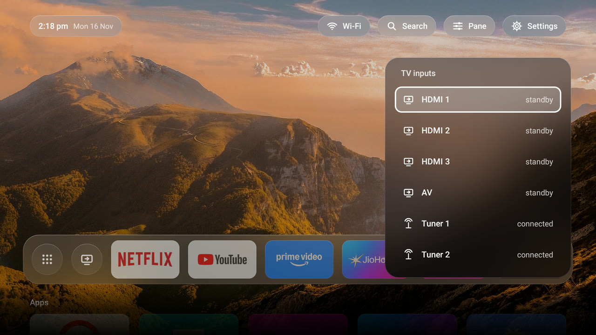
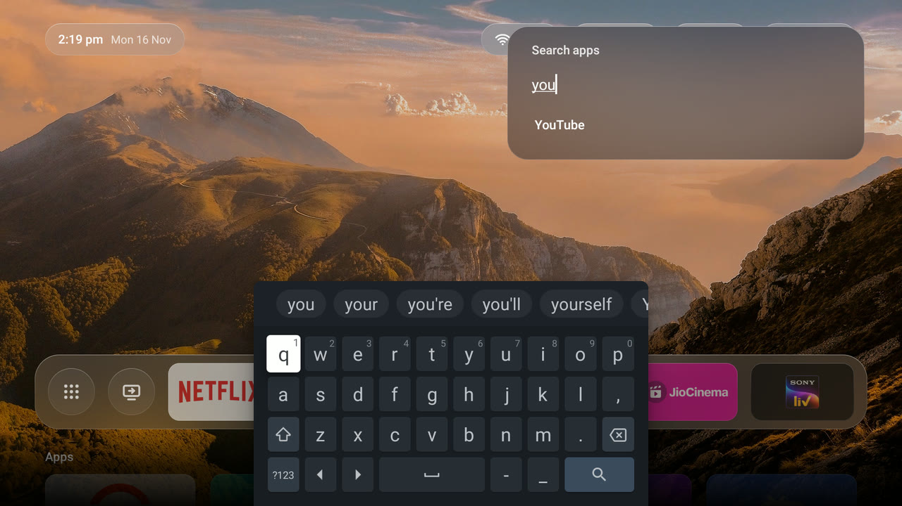
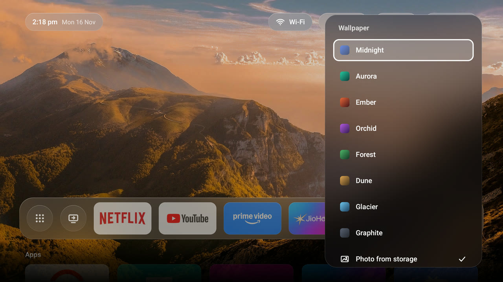
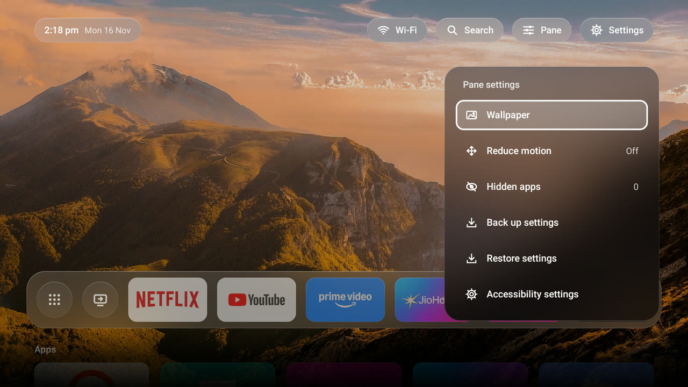

<div align="center">

# Pane

**A glass home screen for Android TV that fits in 53 KB and idles at 31 MB.**

Built for a 2 GB TV that had become painfully slow. Free and open source.



</div>

<br>

## Why

Cheap TVs ship with 2 GB of RAM and a launcher that eats a good part of it. Every
megabyte the home screen holds is a megabyte your streaming app does not get, and
that is what makes the whole TV feel slow.

Pane is a launcher written to use as little as possible and never drop a frame.

| Measured on the same TV | Idle memory | Graphics memory |
|---|---:|---:|
| **Pane** | **31 MB** | **12 MB** |
| A Jetpack Compose launcher | 71 to 118 MB | 35 to 58 MB |
| Stock Google TV launcher | 140 MB | |
| Xiaomi PatchWall | 173 MB | |

| | Pane | Compose launcher |
|---|---:|---:|
| Frames that miss 60 fps while navigating | **0.3%** | 100% |
| Median frame time | **7 ms** | 34 ms |
| Cold start | **0.44 s** | 0.46 s |
| App size | **53 KB** | |

That is roughly 4x to 5x less memory than the launchers the TV came with, and
navigation that stays under half of the 16.7 ms frame budget.

<sub>Xiaomi Mi TV, MediaTek quad Cortex-A55, 2 GB RAM, Android 10, 1080p. Memory is PSS from
`dumpsys meminfo` 15 s after pressing Home. Frame numbers are from `dumpsys gfxinfo`.</sub>

<br>

## A look around

<table>
  <tr>
    <td width="50%"></td>
    <td width="50%"></td>
  </tr>
  <tr>
    <td align="center"><sub>Press Down and the page glides into every app</sub></td>
    <td align="center"><sub>Hold OK on any app: dock, move, hide, info</sub></td>
  </tr>
  <tr>
    <td></td>
    <td></td>
  </tr>
  <tr>
    <td align="center"><sub>Switch HDMI, AV and antenna from Home</sub></td>
    <td align="center"><sub>Start typing to search</sub></td>
  </tr>
  <tr>
    <td></td>
    <td></td>
  </tr>
  <tr>
    <td align="center"><sub>Eight gradients, or any photo of your own</sub></td>
    <td align="center"><sub>A short settings list, nothing buried</sub></td>
  </tr>
</table>

<br>

## What you get

- **A dock for the apps you actually open.** Up to six, sized to fit. The focused
  app is bright and lifted; everything else steps back.
- **Every other app one press away.** The page continues below the dock. The next
  row peeks in through a dark fade so you know it is there.
- **TV inputs.** HDMI, AV and tuner, with their connection state, straight from Home.
- **Search by typing.** From a keyboard or a phone remote app, just start typing.
- **Your wallpaper.** Eight built-in gradients, or any photo from the TV's Pictures
  or Download folder or a USB drive.
- **Tidy up.** Move, hide, uninstall, or open app info from a long-press menu.
- **Backup and restore** of your layout as one small JSON file.
- **Reduce motion** switch, screen-reader labels on everything, and it follows the
  system font size.
- **Quiet by design.** No account, no ads, no analytics, no background services,
  and no internet permission at all.

<br>

## Install

Download **[Pane-1.0.apk](https://github.com/shanmukhram/MyPane/releases/latest)** from
the latest release. You need a computer with
[adb](https://developer.android.com/tools/releases/platform-tools) and a TV with
developer options and network debugging turned on.

```bash
adb connect <your-tv-ip>:5555
adb install -r Pane-1.0.apk
adb shell cmd package set-home-activity tv.pane.launcher/.MainActivity
```

Press Home. That's it.

One optional step makes cold starts twice as fast right away. Android does this by
itself after a day or so; this just does it now:

```bash
adb shell cmd package compile -m speed -f tv.pane.launcher
```

To go back, set your old launcher as Home again with the same `set-home-activity`
command, or uninstall Pane with `adb uninstall tv.pane.launcher`.

### Build it yourself

JDK 17, the Android SDK (platform 34, build-tools 34) and Gradle 8.9. There are no
other dependencies to fetch.

```bash
gradle :app:assembleRelease
```

The APK lands in `app/build/outputs/apk/release/`.

<br>

## Using it

| On the remote | What happens |
|---|---|
| Left / Right | Move along the dock |
| Down | Glide into all apps |
| Up or Back | Return to the dock |
| OK | Open |
| Hold OK, or Menu | App menu: add to dock, move, hide, info, uninstall |
| Round grid button | Jump to all apps |
| Round screen button | TV inputs |

<br>

## How it stays this light

- **Plain Android Views, no UI framework.** One custom-drawn View per tile, no
  nested layouts, no libraries. That is where most of the memory saving comes from.
- **Glass without live blur.** The wallpaper is blurred once and cached. Each glass
  panel draws the matching crop of that copy in a single pass, so there is no
  per-frame blur at all.
- **Springs on the display's own clock.** Motion is driven from `Choreographer` and
  only ever changes position, scale and opacity, so it keeps working even when
  system animations are switched off.
- **Artwork only where you can see it.** Banners are rendered at display size, kept
  as GPU-only bitmaps in a 6 MB cache, saved to disk, and released the moment Home
  goes to the background.
- **No full-screen fades or zooms.** On a low-end TV GPU they cannot hold 60 fps.
  Moving things can, which is why apps scroll into view instead of a panel opening.

Kotlin was a deliberate choice over Rust. Measured on the TV, a frame spends under
1 ms in the app's own code and 4 to 8 ms issuing drawing to the GPU, so a faster
language would not make it faster, and a custom renderer would have to rebuild the
focus handling and screen-reader support that Views provide.

<br>

## Good to know

- Built and tested on one TV: a Xiaomi Mi TV on Android 10. It should run on any
  Android TV from Android 8 up, but other models are untested. Reports are welcome.
- Input switching hands off to the TV's own live-TV app, so it depends on the
  manufacturer shipping one.
- The very first scroll after a restart can hitch for a moment while the GPU
  prepares artwork. After that it is smooth.
- With 166 apps installed, memory held steady at about 42 MB through ten rounds of
  opening an app, coming back and scrolling the whole list.

<br>

## Contributing

Issues and pull requests are welcome, especially results from other TVs. Please
keep the two rules the project lives by: no new dependencies, and measure before
and after.

## Credits

Wallpapers in the screenshots are photos by Cristina Gottardi, Jonatan Pie and
Urban Vintage on [Unsplash](https://unsplash.com). They are not part of this
repository. App banners belong to their respective owners.

## License

[MIT](LICENSE). Use it, change it, ship it.
